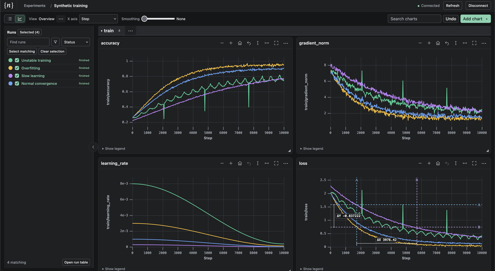

# Not Shitty Experiment Tracker

A self-hosted experiment tracker for inspecting and comparing training runs. One executable serves the browser UI and accepts metrics over the network—no separate database service or gateway.



Filter runs by configuration, compare full-resolution curves, zoom into spikes, and measure differences with cursors. Plot against step, time, or another metric; save your chart layouts. Native image timelines are supported too.

## Set up and launch

Install Pixi and a C/C++ build toolchain, then build from source:

```sh
git clone https://github.com/Blair-Johnson/nset.git
cd nset
pixi run web-install
pixi run build
```

Choose an access token, then start the server:

```sh
export NSET_TOKEN='replace-this-with-your-own-random-access-token'
./target/release/nset serve --host 127.0.0.1 --port 8080 \
  --token "$NSET_TOKEN" --db-path ./nset-data
```

Open `http://127.0.0.1:8080` and enter the same token. Use at least 40 characters for W&B clients. `--db-path` holds the server's data; the built executable needs neither Python nor Node to run.

Use `--host 0.0.0.0` for remote clients, with HTTPS or a tunnel on untrusted networks. Run `./target/release/nset serve --help` for other options.

## Log data

Install the native client in your training environment from this checkout:

```sh
pip install ./python
```

Set `NSET_TOKEN` to the server's token in that environment, then:

```python
import os
from nset_client import Client

client = Client("http://127.0.0.1:8080", token=os.environ["NSET_TOKEN"])
experiment = client.experiment("My experiment")

with client.start_run(experiment, "baseline", params={"lr": 0.001}) as run:
    for step, loss in enumerate([1.2, 0.7, 0.3]):
        run.log_metrics({"train/loss": loss}, step=step)
```

Refresh the experiment list, select your runs, and open Charts to compare them.

Already using MLflow or W&B? Keep your existing tracking calls and point the client at the same server:

```sh
export MLFLOW_TRACKING_URI=http://127.0.0.1:8080
export MLFLOW_TRACKING_TOKEN="$NSET_TOKEN"
export WANDB_BASE_URL=http://127.0.0.1:8080
export WANDB_API_KEY="$NSET_TOKEN"
export WANDB_ENTITY=local
```

Tracking compatibility is a subset, not full vendor parity. See [supported clients](docs/client-compatibility.md) for details and TensorBoard event ingestion.

[Chart controls](web/README.md) · [Durable delivery](docs/durable-ingestion.md) · [Build and development](docs/contributing.md)
